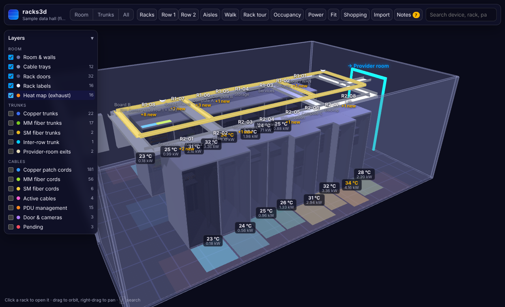
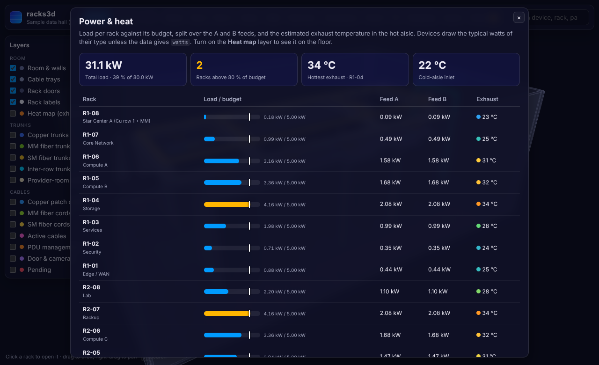
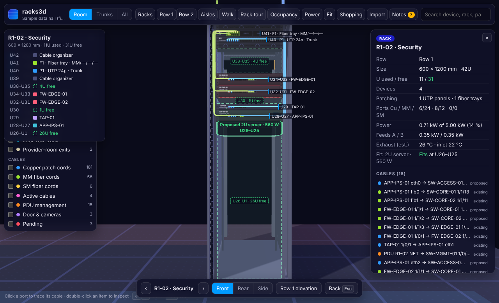
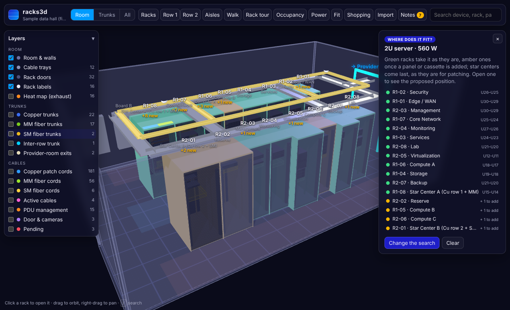
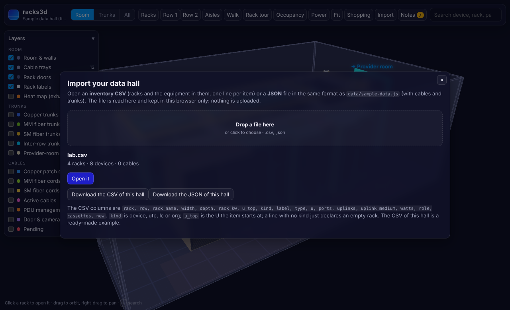

# racks3d

A static, browser-only **3D digital twin of a data hall**: racks, equipment, patch panels, star centers,
trunks and cables, navigable in 3D with a dark NOC look.

Everything in this repository is **fictitious sample data**: generic equipment types, made-up names,
no vendors, no models, no addresses, no real site.

- Plain HTML + CSS + JavaScript, **no framework and no build step**.
- Three.js 0.147.0 shipped locally in `js/vendor/` (classic scripts), so it works from GitHub Pages
  **and** by double-clicking `index.html` (`file://`).
- 1 scene unit = 1 metre. 1U = 44.45 mm, 19" = 482.6 mm, racks of 600/800 mm × 1000/1200 mm, 42U.

## Open it

- **Locally:** double-click `index.html`.
- **GitHub Pages:** *Settings → Pages → Deploy from a branch → `main` / root*. The site is then served at
  `https://<user>.github.io/racks3d/`.

## What you can do

| View | How |
|---|---|
| Room (default) | Clean view without cables. Levels **Room / Trunks / All**, plus the **Layers** panel with a counter per layer. |
| Rack | Click a rack. Only that rack is shown, with the U ruler, item labels, free space marked in dashed green (“U17–U1 · 17U free”), its patch cords and trunks cut where they leave the rack, and the full elevation (U42 → U1). Use ‹ › or ←/→ to move between racks, and Front / Rear / Side to change the angle. The mouse wheel zooms toward the pointer, so you can get close to any U; right-drag moves the view. |
| Row elevation | **Row 1 / Row 2**: every rack of the row seen from the front or rear with little perspective (FOV 24°), with used and free U below. |
| Aisles | Eye-level camera in the cold or hot aisles. You can look at either row or along the aisle, and move with the slider or ←/→. |
| Walk | First-person walk: from outside the door into the cold aisle, turning to each pair of facing racks with a placard (function, U used/free, devices, cables, items to order). Pause, ‹ ›, 1×/2×, “View this rack in detail” (Esc brings you back to the same point). |
| Rack tour | Opens every rack in turn, from the front, with a summary. |
| Racks | Mini plan of the rows in physical order. Hovering a rack lights it up in 3D; clicking opens it; “View full row” opens the row elevation. |
| Search | Device, type, rack or panel (`R1-04 P2`), with ↑↓ and Enter. Says when something is not in any rack. |
| Inspect | Double-click an item: studio view with dimensions, Front / Isometric / Rear / Top, and clickable ports. |
| Trace | Click a port, a cable in a card or search a cable id: the camera walks along it stop by stop, from one end through every panel port to the other (‹ ›, ← →, or **▶ Walk it** to play it), with the walked part in amber, data packets running along it, and the next hop in white. **Whole path in the room** stands back with every stop numbered. Racks and equipment the cable does not touch fade to glass, and while walking every rack but the current one does. |
| Occupancy / Shopping / Notes | Ports per rack and medium with the +30 % mark, a CSV shopping list, and rule-based observations. |
| Power | Load per rack against its budget, the A and B feeds, and the estimated exhaust temperature. The **Heat map** layer colours the hot-aisle floor behind each rack. |
| Fit | “Where does it fit?”: describe a device and every rack is checked for free U, patching ports and power. Racks glow green or amber, and a ghost of the device shows where it would go. |
| Import | Open your own inventory CSV or a JSON data file. It is checked first, kept in this browser only, and drawn instead of the sample. |



`Esc` always goes back one step (studio → modal → trace → previous view).

## Power and heat

Every device draws the typical watts of its type (switch 180 W, router 350 W, firewall 250 W, server 280 W
per U, storage 380 W per U, chassis 900 W, appliance 150 W, TAP 60 W, wireless controller 120 W), or its
own `watts`. Each rack has a budget, `power.rackKw` for the whole hall or `powerKw` on a rack, fed by two
PDUs (A and B) that share the load. With 2N feeds each one must be able to carry the whole rack alone, so a
rack over its budget is flagged red, and one above 80 % amber; both appear in **Notes** too.

The exhaust temperature is an **estimate**, not a measurement: the inlet is the cold-aisle temperature
(`power.inletC`, 22 °C) and the fans are assumed to be sized for the budget (`power.cfmPerKw`, 120 CFM per
kW), so ΔT (°C) = 1.76 × W ÷ CFM, the sensible-heat rule usually written ΔT (°F) = 3.16 × W ÷ CFM. A rack at
its full budget runs about 15 °C over the inlet. It is enough to see which racks will run hot.

| Power panel | Rack card |
|---|---|
|  |  |

## Where does it fit?

**Fit** opens a form: pick a preset (1U or 2U server, storage, access switch, edge router, blade chassis) or
set the height, the copper and fiber ports it needs patched, single- or multimode, and its watts. Every
rack is then checked for:

- a free run of U at least as tall as the device,
- free ports on its trunk UTP panels and cassettes; when they run short, the panels, cassettes in empty
  slots or new trays to add are listed, and they need free U too,
- power: the rack's load plus the device must stay within its budget.

Racks that take it as they are come first, then those that need a panel or cassette, with star centers
after the others as they are for patching. **Show in 3D** lights them green or amber in the room and puts
a ghost of the device at its proposed U in each one; open a rack to see it in place.



## Import your own data

**Import** opens a file from your computer: nothing is uploaded, and the data is kept in this browser's
local storage until you choose **Back to the sample**. `?data=private` still takes precedence.

- **Inventory CSV**: one line per item, in the rack and at the U it starts at. A line with no `kind` just
  declares an empty rack. Cables and trunks are not part of it.

  | column | meaning |
  |---|---|
  | `rack`, `row`, `rack_name`, `width`, `depth`, `rack_kw` | the rack (mm, and its power budget in kW) |
  | `u_top` | the top U of the item, 1–42 |
  | `kind` | `device`, `utp` (patch panel), `lc` (fiber tray) or `org` (cable organizer) |
  | `label`, `type`, `u`, `ports`, `uplinks`, `uplink_medium`, `watts` | for a device |
  | `role`, `cassettes` | for a panel (`trunk`, `pdu`, …) and a tray (`mm\|mm\|\|sm`) |
  | `new` | `yes` for an item still to order |

  [docs/example-inventory.csv](docs/example-inventory.csv) is a small hand-written one, and Import can
  download the CSV of the hall on screen as a template.
- **JSON** in the same format as `data/sample-data.js`, with cables and trunks (a `.js` data file works too).

Before it opens, the file goes through the same validation as the tests, and every problem is listed with
its line: overlapping items, a U outside 1–42, a label used twice, a hop on a panel that does not exist…



## Tests

```bash
node --test                     # the data and the planning helpers
python3 tools/check_public.py   # the privacy check
```

`test/plan.test.mjs` checks that the sample has no errors or warnings, that every kind of mistake is caught
by the validation, and the power, fit and CSV helpers on small hand-made racks. A GitHub Actions workflow
(`.github/workflows/checks.yml`) runs both on every push and pull request.

## Publish it on GitHub Pages

1. On GitHub: **Settings → Pages**.
2. Under **Build and deployment**, *Source*: **Deploy from a branch**; *Branch*: **main**, folder **/ (root)**;
   **Save**.
3. After a minute the site is at `https://<user>.github.io/racks3d/`. Put that link in the repository's
   **About** box so visitors find it.

## Files

```
index.html               page and UI skeleton
css/racks3d.css          styles (CSS variables, glass panels, responsive)
js/racks3d.js            the whole app: scene, cables, views, panels
js/plan.js               no 3D: validation, power and heat, free ports, “where does it fit?”, inventory CSV
js/import.js             loads a data set imported in this browser instead of the sample
js/vendor/               three.min.js, OrbitControls, CSS2DRenderer, RoomEnvironment, BufferGeometryUtils (0.147.0) + license
data/sample-data.js      generated fictitious data set (window.DC_DATA)
tools/generate_sample.py builds data/sample-data.js (no dependencies)
tools/check_public.py    privacy check, run it before every publish
tools/blocklist.example.txt  template for your private word list
test/plan.test.mjs       node --test: the sample data and the planning helpers
docs/screenshots/        screenshots of the app with the sample data (the only images allowed)
docs/example-inventory.csv   a small inventory CSV to try Import with
```

## Data model

One global, loaded as a classic script (no `fetch`, which fails on `file://`):

```js
window.DC_DATA = {
  meta:  { title: "Sample data hall (fictitious)", reserve: 1.3 },
  power: { rackKw: 5, inletC: 22, cfmPerKw: 120 },  // budget per rack, cold-aisle °C, airflow per kW
  room:  { coldAisle: 1.2, hotAisle: 1.0, rackHeight: 2.0,
           trayHeights: { copper: 2.3, fiber: 2.5 },
           crossTrays: [1.2, 4.2] },                 // metres from the start of the rows
  starCenters: { copper: ["R1-08", "R2-01"], mm: "R1-08", sm: "R2-01" },
  rows:  { "1": ["R1-08", "R1-07", /* … */ "R1-01"],   // physical order, left → right seen from the cold aisle
           "2": ["R2-08", /* … */ "R2-01"] },
  racks: [
    { id: "R1-03", name: "Services", width: 800, depth: 1000, row: 1,   // powerKw: 8 overrides the budget
      starCenter: null,                               // or ["copper"], ["copper", "mm"], …
      items: [                                        // TOP → BOTTOM, U positions are computed
        { kind: "org" },                              // 1U cable organizer
        { kind: "lc", id: "F1", cassettes: [{ medium: "mm" }, null, null, null] },  // 1U tray, 4 × 12 duplex
        { kind: "utp", id: "P1", role: "trunk" },     // 24-port panel: trunk | pdu | camera | exit | existing
        { kind: "utp", id: "P2", role: "trunk", isNew: true },                     // to order → drawn in amber
        { kind: "gap", u: 3 },
        { kind: "device", label: "SRV-APP-01", type: "server", u: 2, ports: 2, uplinks: 2, uplinkMedium: "mm" }   // watts: 600 overrides the typical draw
      ] }
  ],
  externals: [ { id: "PROVIDER-ROOM", type: "provider", label: "Provider room", place: "portal" } ],
  trunks: [ { medium: "copper", a: "R1-03#P1", b: "R1-08#P5" },
            { medium: "mm", a: "R1-03#F1.C1", b: "R1-08#F2.C3" },             // one MPO trunk per cassette
            { medium: "copper", a: "R1-08#P8", b: "R2-01#P10", interRow: true } ],
  cables: [ { id: "c1", medium: "copper", kind: "structured", status: "existing",
              a: { item: "SRV-APP-01", port: "eth0" },
              hops: ["R1-03#P1:5", "R1-08#P5:5", "R1-08#P3:5", "R1-06#P1:5"],
              b: { item: "SW-ACCESS-01", port: "1/0/5" } } ],
  notes: []
};
```

- **Device types:** `switch`, `router`, `firewall`, `server`, `storage`, `chassis`, `appliance`, `tap`, `wlc`.
  Faces are drawn by code from `type`, `u` and `ports`. There are no images and no brands.
- **Port names** come from the type. Switch-like devices use `1/0/n` for copper and `1/1/n` for fiber;
  the other types use `eth0…` and `fib0…`. Every device also has `mgmt` unless `mgmt: false`.
- **Hops** are panel ports in order: `R1-03#P1:5` is UTP panel P1, port 5; `R1-03#F1:14` is fiber tray F1,
  port 14 (cassette 2, position 2). Between two racks a hop pair must be joined by a trunk. Inside one rack
  it is a patch cord, which is the cross-connect in a star center.
- **Cable kinds:** `structured`, `mgmt`, `direct` (same rack, no star center), `active` (fixed length, laid in
  the tray, no panels), `pdu` (`a.item: "PDU:R1-03"`), `door` (door controller and cameras), `exit` (to the
  provider room).
- **Status:** `existing`, `proposed` or `pending` (pending is drawn in red).

Occupancy, the shopping list and the observations are **recomputed in the browser** from this data, so
they change when you edit `sample-data.js` or regenerate it.

## Generate the sample

```bash
python3 tools/generate_sample.py                     # 2 rows × 8 racks (default)
python3 tools/generate_sample.py --rows 2 --per-row 6 --seed 3
```

The generator:

1. Builds the rows of fictitious racks (600 and 800 mm) with generic equipment and free space.
2. Assigns every cable **port by port**: device → next free port of the rack's trunk panel → the same port on
   the star center → (inter-row trunk if needed) → destination rack → device.
3. When a rack needs more ports than installed **+30 % reserve**, it adds new panels or cassettes
   (`isNew: true`, drawn in amber) and their counterparts in the star center.
4. Writes `data/sample-data.js` and prints a summary of what has to be bought.

## Using your own data without publishing it

The public repository only carries the fictitious example. To work with real data:

1. Create `data/private-data.js` with the same schema (`window.DC_DATA = {...}`). It is listed in
   `.gitignore`, along with `private/`.
2. Open `index.html?data=private`. The private file then overrides the sample. Without the parameter, or
   without the file, the site keeps working with the sample.
3. Typical sources for building that file (keep the scripts and exports in `private/`):
   - an **inventory CSV** (rack, U, name, type, size) → `racks[].items`
   - an **LLDP/CDP neighbors export** → `cables[]` (device A port ↔ device B port)
   - your **patching plan** (panel / port per link) → `cables[].hops` and `trunks[]`

   You can reuse the routing in `tools/generate_sample.py`, which assigns ports and adds panels from a list
   of connections, by replacing `plan()` with a reader of your files and writing to `data/private-data.js`.

## Privacy checklist (before every commit)

- [ ] Nothing real: no company, site, building, room, city, address or floor plan.
- [ ] No hostnames, IPs, VLANs, serial numbers, real interface names, port descriptions, circuits,
      service providers, contracts or people. Use made-up names (`SW-ACCESS-01`, `RTR-EDGE-01`) and, if
      needed, documentation IPs (`192.0.2.0/24`, `198.51.100.0/24`, `203.0.113.0/24`).
- [ ] No brands or models of equipment, panels, racks or cabling, only generic types.
- [ ] No photos of real equipment or rooms, and no images downloaded from manufacturers or shops. Only
      code-drawn faces, and PNG screenshots of this app with the sample data in `docs/screenshots/`.
- [ ] Real data only in ignored files (`data/private-*.js`, `private/`), or imported in the browser with
      **Import**, which keeps it on your computer.
- [ ] `cp tools/blocklist.example.txt tools/blocklist.txt`, add your own words, then run
      `python3 tools/check_public.py`. It must report **no findings**.
- [ ] When in doubt whether something is sensitive, leave it out.

## Credits

3D rendering by [three.js](https://threejs.org) (MIT, see `js/vendor/THREE-LICENSE`).
